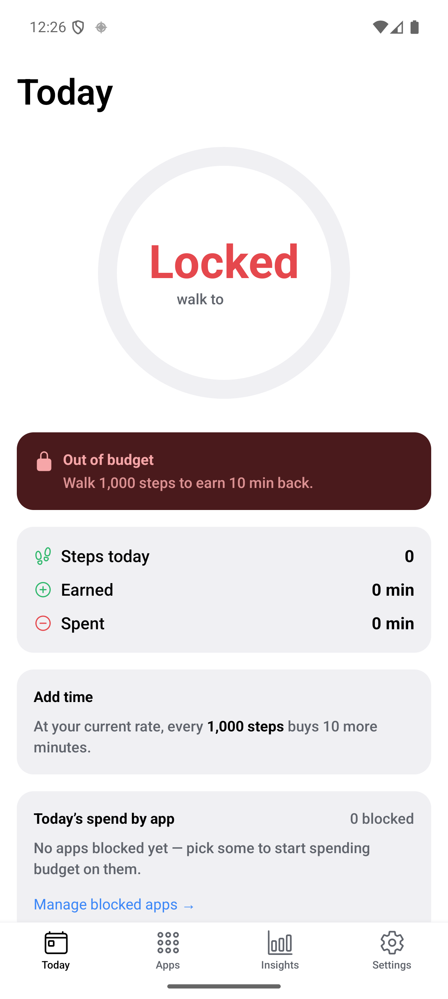
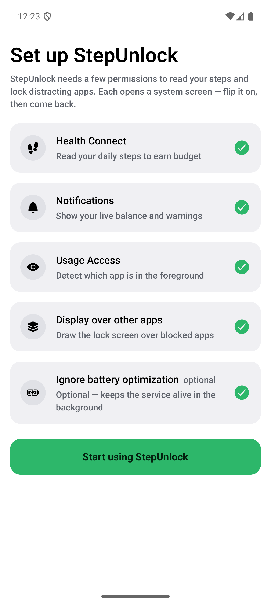
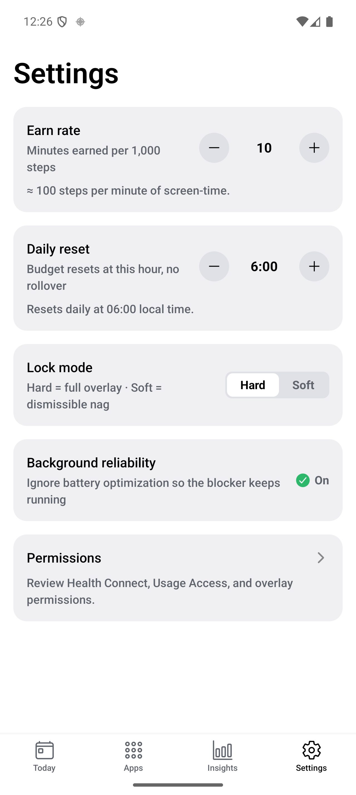
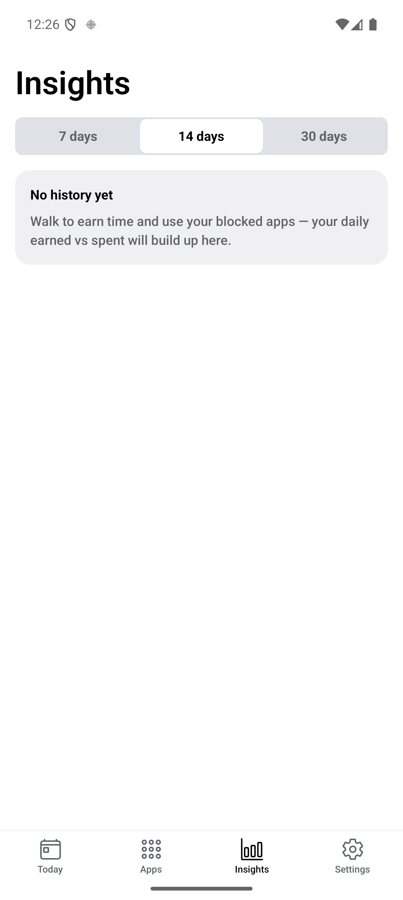

# StepUnlock

**Walk to earn your scroll.**

StepUnlock turns walking into earned screen time. Your steps buy minutes in distracting apps — and when the budget runs out, those apps lock behind a full-screen overlay until you move again.

<p>
  
  
  
  
</p>

*Screenshots from a real run on Android (Pixel 9 Pro emulator, API 35).*

## How it works

1. **Walk** — StepUnlock reads your daily steps on-device via Health Connect.
2. **Earn** — Every 1,000 steps earns 10 minutes of screen time (adjustable).
3. **Spend** — Time spent in apps you choose drains the budget live.
4. **Lock** — At zero, blocked apps are covered by a full-screen overlay. Walk to unlock.

The budget resets daily at 06:00 local time. No rollover, no cheating it — `remaining` is always derived from steps minus spend, never stored.

## Screens

| Screen | What it does |
|--------|--------------|
| **Today** | Live balance ring (earned / warning / locked), steps-earned-spent stats, per-app spend breakdown |
| **Apps** | Searchable list of installed apps with per-app block toggles |
| **Insights** | 7 / 14 / 30-day history of earned-vs-spent, so you can see the habit forming |
| **Settings** | Earn rate, daily reset hour, lock mode, background reliability, permission review |
| **Onboarding** | Guided permission setup — Health Connect, notifications, usage access, overlay, battery exemption |

Lock mode is your choice: **Hard** (full overlay, no dismissal) or **Soft** (dismissible nudge).

## Privacy

On-device only. There is no backend, no account, and no analytics:

- Steps stay on your phone (Health Connect, no cloud).
- Budget, blocked apps, and history live in local encrypted storage (MMKV + Zustand).
- No network calls. No `.env`, no API keys — there is nothing to leak.

## Built with

- **Expo** (SDK 56) + **React Native** + **expo-router** — UI and navigation
- **Health Connect** (`react-native-health-connect`) — step source
- **3 local native modules** (`modules/`) —
  - `blocker`: foreground-service usage detection, spend tracking, lock overlay, boot survival
  - `system-permissions`: usage-access / overlay / battery deep-links and checks
  - `installed-apps`: launchable-app picker list
- **Zustand + MMKV** — state; balance derived via `src/lib/budget.ts`

## Run it

Android-only (Health Connect and app-blocking are Android-specific). You'll need the Android SDK and an emulator (Pixel, API 35+) or a physical device.

```bash
npm install
npx expo run:android   # prebuild + build dev client + install + start Metro
```

JS changes hot-reload via Metro. Native, manifest, or config-plugin changes need a rebuild (`npx expo run:android` again).

> On an emulator there is no real step source. The dev build includes a
> **"+ Add 1,000 test steps"** button on the Today screen to seed Health
> Connect and exercise the earn loop.

## Project layout

```
src/
  app/            expo-router routes: onboarding + (tabs) today / apps / insights / settings
  components/     BalanceRing, Banner, Card, themed primitives
  lib/            budget.ts (earn/spend math), healthConnect.ts, day.ts, format.ts
  state/          zustand + MMKV store (blocked apps, spend, settings, history)
modules/          local Expo native modules (blocker, system-permissions, installed-apps)
plugins/          config plugins (manifest extras, Health Connect wiring)
docs/             PRD + technical design doc
```

## Status

| Phase | Scope | State |
|-------|-------|-------|
| **0** | Project setup, Health Connect reads on-device | ✅ done |
| **1** | Earn loop (steps → live balance), app picker, settings, onboarding | ✅ done |
| **2** | Foreground-service detection + spend + native step reads | ✅ done |
| **3** | The lock: warning → countdown → overlay → auto-clear | ✅ done |
| **3+** | Per-app spend breakdown, reboot survival (BootReceiver) | ✅ done |
| **4** | Battery-optimization exemption, history / insights | ✅ done |

## License

MIT — see [LICENSE](./LICENSE).
